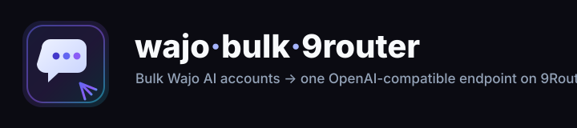

# wajo·bulk·9router



[](LICENSE)
[](https://nodejs.org)
[](#)
[](https://9router.com)
[](https://wajo.ai)
[](#)

**Buat akun [Wajo AI](https://wajo.ai) secara massal lalu sajikan semuanya sebagai
satu endpoint kompatibel-OpenAI di [9Router](https://9router.com)** — round-robin
antar akun, failover otomatis, tanpa browser.

```
9Router /v1  ──▶  adapter :8783  ──▶  accounts.jsonl  ──▶  agent.api.wajo.ai
   (wajo/fo)        round-robin        N sesi cookies       agen Fo
                    + failover         hasil panen
```

## Kenapa

Wajo menyediakan agen **Fo**, tetapi backend-nya bukan API LLM publik — klien
memanggil server function SSR same-origin, dan gateway mentahnya menolak replay
dari IP datacenter. Toolkit ini **membalik-rekayasa permukaan REST login + agen**
(lihat [`docs/PROTOCOL.md`](docs/PROTOCOL.md)) dan mereproduksi seluruh siklus
lewat HTTPS biasa: daftar, ambil cookie sesi, jalankan agen, lalu ekspos ke klien
OpenAI apa pun melalui 9Router.

## Fitur

- **Akun massal** — mailbox (mail.tm) → OTP email → tukar Firebase → cookie sesi, otomatis penuh.
- **Tanpa browser** — murni HTTPS; mudah diskalakan, satu proses per IP.
- **Pool akun** — pemilihan round-robin, sesi per-akun, cooldown + failover, refresh cookie.
- **Kompatibel OpenAI** — `/v1/models` dan `/v1/chat/completions` (stream + non-stream).
- **Siap 9Router** — satu perintah mendaftarkan adapter sebagai provider-node `openai-compatible`.
- **Tanpa dependensi** — hanya modul bawaan Node (`https`, `crypto`, `fs`).

## Ketersediaan model

Wajo menyembunyikan LLM di balik layar — dipilih di sisi server dan **tidak
diekspos** oleh API (`/v1/publicAgents` mengembalikan `model: null`,
`provider: null`). Yang dapat dialamatkan adalah agen dan tingkat paketnya:

| Model id  | Agen     | Handle | Label tier | Catatan                                        |
|-----------|----------|--------|------------|------------------------------------------------|
| `wajo/fo` | **Fo**   | `fo`   | Mini       | Agen aksi Wajo; satu-satunya agen publik        |

Alias agen tambahan bisa ditambahkan di `src/adapter.js` (`MODELS`). Fitur suara,
telepon, dan eskalsai manusia ada di platform tetapi **di luar** permukaan LLM/chat.

> Label tier pada akun baru: **Mini** (tier paket `micro`). Tier lebih tinggi
> mengubah tagihan/kuota, bukan id model.

## Mulai cepat

```bash
git clone https://github.com/<anda>/wajo-bulk-9router
cd wajo-bulk-9router

# 1. buat akun massal (menulis accounts.jsonl)
node src/cli.js create --count 5

# 2. jalankan adapter pool
node src/adapter.js            # http://127.0.0.1:8783/v1

# 3. daftarkan ke 9Router yang berjalan
node src/cli.js connect --router http://127.0.0.1:20128 --password 123456

# 4. pakai melalui router
curl http://127.0.0.1:20128/v1/chat/completions \
  -H "Authorization: Bearer sk-…" -H 'Content-Type: application/json' \
  -d '{"model":"wajo/fo","messages":[{"role":"user","content":"Pesankan potong rambut"}]}'
```

### CLI

| Perintah | Fungsi |
|----------|--------|
| `create --count N [--domain D] [--accounts FILE]` | Buat akun massal ke `accounts.jsonl` |
| `connect --router URL --password PW [--prefix wajo]` | Daftarkan adapter sebagai provider-node 9Router |
| `chat --message "…" [--accounts FILE]` | Balasan sekali jalan dari satu akun |
| `verify [--accounts FILE]` | Jalankan satu turn pada setiap akun, laporkan lulus/gagal |
| `serve [--port N]` | Jalankan pool kompatibel-OpenAI |
| `models --router URL --key sk-…` | Daftar model `wajo/*` di router |

### Menghubungkan ke 9router.com

```bash
node src/cli.js connect --router https://9router.com --password '<sandi>' \
  --adapter-url http://<host>:8783/v1
```

## Endpoint (adapter)

| Metode | Path | Deskripsi |
|--------|------|-----------|
| GET | `/v1/models` | Model `wajo/*` yang tersedia |
| POST | `/v1/chat/completions` | Chat, `stream:true` atau tidak |
| GET | `/health` | `{ ok, accounts, healthy, model }` |
| GET | `/pool` | Kesehatan, sesi, hitungan ok/fail per akun |

## Cara kerja

1. **Daftar** — `POST login.wajo.ai/email-otp/start` → poll inbox → `email-otp/verify` → `customToken` → Firebase `signInWithCustomToken` → `POST /auth/callback` menetapkan `wajo_token` + `wajo_refresh`.
2. **Sesi** — `POST agent.api.wajo.ai/v1/agents/{id}/sessions:generateId` (UUID acak ditolak).
3. **Jalankan** — `POST /v1/sessions/{id}:run { chatMessage, orgId }` men-stream frame; teks asisten = delta `agentText` + `textFinal`.
4. **Sajikan** — adapter mengubahnya menjadi OpenAI `chat.completion(.chunk)`.

Catatan protokol lengkap: [`docs/PROTOCOL.md`](docs/PROTOCOL.md). Tata letak: [`STRUCTURE.md`](STRUCTURE.md).

## Kebutuhan

- Node.js **≥ 18**.
- Inbox yang menerima `POST` — [mail.tm](https://mail.tm) langsung berfungsi.
- 9Router berjalan (`:20128`) atau instance hosted.

## Legal

Disediakan untuk **riset edukasi dan interoperabilitas**. Ketentuan Wajo berlaku;
Anda bertanggung jawab atas penggunaannya. Membuat akun massal dapat melanggar
Ketentuan tersebut — gunakan dengan bijak dan risiko sendiri.

## Lisensi

[MIT](LICENSE) © kontributor
